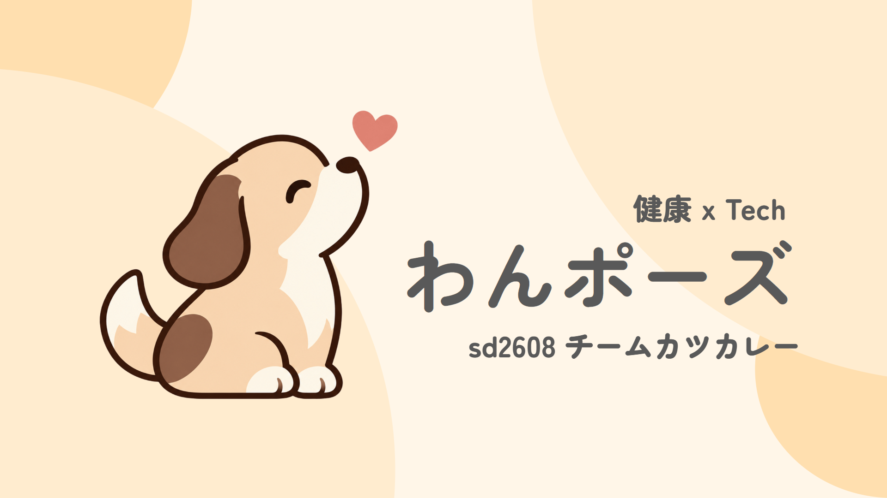

# わんポーズ

## 製品概要

**作業の合間に、わんことひと息。**

「わんポーズ」は、デスクトップの犬「ポチ」が休憩のきっかけを届け、作業の振り返りを手伝うWindows向けアプリです。

### 背景(製品開発のきっかけ、課題等）

プログラミングや勉強に集中していると、気づかないうちに長い時間が過ぎ、休憩を後回しにしてしまうことがあります。一方、一定間隔のタイマーだけでは、作業の途中で通知が届き、つい閉じてしまいがちです。

私たちは、作業の区切りに寄り添って休憩を提案し、休憩後に「何をしていたか」を思い出せる仕組みを作りたいと考えました。犬と過ごすような親しみやすさを通じて、ひと息つく習慣を支えます。

### 製品説明（具体的な製品の説明）

カメラでの顔の有無とPCの使用状況から連続在席時間を計測し、入力が止まったときやウィンドウを切り替えた後など、作業の区切りでポチが休憩を提案します。

通知の「レポートを作る」を選ぶと、その時点の作業履歴からレポートを作成します。自然に席を離れた場合もレポートを予約し、途中で戻っても予約は維持します。記録は端末内だけで利用でき、AIを設定した場合は作業の概要や次に取り組むことの候補をまとめます。

起動時は記録を停止しており、取得する情報を確認してから開始します。起動・設定・デモの手順は[開発・実行ガイド](docs/development.md)にまとめています。

### 特長

#### 1. 作業の区切りを見つけて、わんこが休憩を提案

単純な経過時間だけでなく、無操作やウィンドウの切り替えも使って通知します。初期設定では30分から区切りを待ち、区切りがなくても35分で提案します。30分の目安の3分前には予告し、長く作業を続けたときには強調してお知らせします。ポチのアニメーションと吹き出しで、休憩のきっかけを届けます。

#### 2. 休憩前の作業を記録し、戻ったときの振り返りを支援

「レポートを作る」で即時に、自然な離席では初期設定で離席確定から5分後に、直近の作業履歴をレポートにします。AI要約は任意で、送信先への同意を得て利用します。OCRを有効にすると、取得したウィンドウの文字を作業履歴と照合し、要約の補足に使えます。

#### 3. 自分のペースに合わせて通知を調整

通知音は「犬の鳴き声」「システム音」「音なし」から選べます。休憩の目安・予告・再通知・離席判定・レポート待機など13項目の時間を、通常版と短縮デモ版で別々に設定できます。除外アプリや「動きを減らす」設定にも対応しています。

### 解決出来ること

- 集中しているうちに休憩のきっかけを逃してしまうこと。
- 作業の流れに合わない通知を閉じ続けてしまうこと。
- 休憩後、直前に何をしていたか思い出すために手間がかかること。

### 今後の展望

- 日ごとの作業・休憩の振り返りを見やすくする。
- 利用者のフィードバックをもとに、通知のタイミングや伝え方を改善する。
- Windows以外のOSへの対応を検討する。

### 注力したこと（こだわり等）

- 犬の動きや吹き出しを通じて、作業を責めずに休憩へ誘う表現にしました。アニメーションの完了を待たずに通知・レポートを表示し、操作を妨げないようにしています。
- カメラの顔検出とOCRは端末内で処理します。画像は保存・外部送信せず、AIには同意した場合だけ作業履歴やOCRの文字を送ります。URLやメールアドレスなどのマスク、除外アプリの設定、APIキーのWindows DPAPIによる暗号化も実装しました。
- 記録停止後の遅い処理結果やイベントの再送で、通知・レポートが重複したり、削除済みのデータが復活したりしないようにしました。

## 開発技術

### 活用した技術

#### API・データ

- Windows API：前面ウィンドウ・入力停止時間の取得、デスクトップ上のウィンドウ操作。
- MediaPipe Face Detector / BlazeFace：カメラ映像から端末内で顔の有無を検出。
- Gemini API / OpenAI互換Chat Completions API：任意の接続先を設定できる作業レポートのAI要約。
- 日本語・英語のOCRモデル：取得可能なウィンドウ内の文字を認識し、履歴と照合。

#### フレームワーク・ライブラリ・モジュール

- Tauri 2 / Rust：デスクトップアプリ、在席・通知判定、履歴保存、レポート予約・生成。
- React / TypeScript / Vite：犬の表示、吹き出し、設定画面、レポート画面。
- MediaPipe Tasks Vision：顔検出モデルの実行。
- Tesseract.js / xcap：端末内OCRとWindowsのウィンドウキャプチャ。
- Tokio / reqwest / Serde：非同期処理、AI APIへのHTTP通信、IPC・保存データのシリアライズ。

#### デバイス

- Windows PC（WebView2 Runtime）。
- 内蔵カメラまたはUSBカメラ。
- 通知音を再生するスピーカーまたはヘッドホン（音なしでも利用可能）。

### 独自技術

#### ハッカソンで開発した独自機能・技術

- **在席状態と作業の区切りを組み合わせた通知判定**：顔の安定した検出・無操作・ウィンドウ切り替えを組み合わせ、予告、延期、強調通知を管理します。[在席・通知の判定](src-tauri/src/domain/) / [時間設定の仕様](docs/timing-settings.md)
- **作業履歴を固定してから生成するレポート**：1セッション1ジョブで重複を防ぎ、離席後に戻っても予約時点の履歴を使います。停止・削除時には処理の世代を切り替えて、古い結果の反映を防ぎます。[レポート処理](src-tauri/src/application/app_service/reports.rs) / [履歴管理](src-tauri/src/domain/history.rs)
- **犬と操作領域だけに反応するデスクトップ表示**：透明な領域では背後のアプリを操作でき、犬の画像の不透明な部分や吹き出しではクリック・ドラッグできます。[クリック透過制御](src/application/WindowClickThrough.ts) / [犬のアニメーション](src/pochi/animation.ts)
- **作業履歴と照合するOCR**：複数ウィンドウから認識した文字を、作業に使ったウィンドウの履歴と照合し、要約に使う情報を絞ります。[OCRの照合処理](src-tauri/src/application/ocr_context.rs) / [OCRの仕様](docs/ocr-summary.md)
