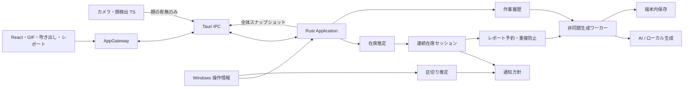

# アーキテクチャ設計

作成日：2026-10-17。**実装に向けた設計であり、現在の `sd_2608` に実装済みという意味ではない。** 要求の正本は [機能要件・仕様](requirements.md)、通信契約は [API 設計](api-design.md)、型の正本は [型・データモデル](data-model.md) とする。

先行実装：共通型、Gateway ポート、表示用コントローラー、モック、UI ひな型を整備した。実センサー・Rust Domain・AI・保存は未接続。[表示開発ガイド](ui-development.md) から phase3 までの表示を先行開発できる。

## 1. 構成と責務

Tauri 2 + React + TypeScript + Rust を使用する。顔検出は WebView 内、PC 情報取得・判定・予約・保存・AI 通信は Rust に置く。**時間判定とレポート予約の実行主体を Rust に集め、画面の開閉・GIF の再生から独立させる。**



| 層・モジュール | 所有する責務 | 所有しない責務 |
|---|---|---|
| Presentation（A） | GIF の再生、吹き出し、選択肢、カード、設定フォーム、画面内の開閉 | センサー取得、時間・在席の判定、AI 呼び出し |
| Presenter / Gateway（B） | 状態を表示用へ変換、操作の転送、IPC とモックの切替、イベントの購読解除 | 通知の時刻・レポート重複の判定 |
| FaceAdapter（B・TS） | カメラの開始・停止、約1秒ごとの顔有無、故障通知 | 画像保存、本人識別、姿勢判定 |
| PresencePolicy（B・Rust） | 顔と入力から `present / uncertain / away / unknown` を推定 | UI と通知時刻 |
| SittingSession（B・Rust） | 連続在席時間、確定離席での終了、新しい在席での開始 | PC を操作した時間の評価 |
| BoundaryPolicy（B・Rust） | 入力停止・前面ウィンドウ切替から「新しい区切り」を抽出 | 離席の確定、通知の強制 |
| ReminderPolicy（B・Rust） | 約30分の提案、No の延期、60分の再通知、回答済み通知の失効 | レポートの文章生成 |
| ReportCoordinator（B・Rust） | Yes／確定離席の受付、5分予約、履歴固定、1セッション1ジョブ | 在席判定、GIF、文章生成の詳細 |
| ReportWorker / Provider（B・Rust） | キュー実行、外部 API またはローカルカード生成、失敗の保存 | 休憩通知の判断 |
| Infrastructure（B） | Windows API、時計、ファイル、キー保護、HTTP | プロダクトの判定ルール |

Domain の関数は `入力 + 現在状態 + 時刻 → 新状態 + イベント` として、副作用を外へ出す。Rust の判定処理から Tauri・HTTP・ファイルへ直接依存しない。

## 2. ディレクトリ案と担当

```text
src/
  contracts/                 # B が契約を管理、変更は A と合意
  components/               # A: PetStage / MessageBubble / ReportPanel / SettingsPanel
  styles/                   # A: コンポーネント単位の CSS
  presentation/             # A: PetAnimator / GIF manifest / 表示だけの状態
  application/              # B: Presenter、React 用 useAppController
  ports/AppGateway.ts       # B: UI の接続口
  adapters/                 # B: TauriGateway / MockGateway / camera
  App.tsx                   # B: 各層の組み立てのみ
public/pet/                 # A: GIF、静止ポーズ、欠損時の代替画像
src-tauri/src/
  domain/                   # B: presence / sitting / boundary / reminder / report
  application/              # B: AppService / ReportCoordinator / domain event 配信
  ports/                    # B: Clock / ActivitySource / ReportProvider / Repository
  infrastructure/           # B: windows / storage / providers / scheduler
  ipc/                      # B: commands / dto / events
  lib.rs                    # B: 依存注入、起動・終了処理
```

## 3. 状態・イベントと実行順序

Rust の `AppService` が正規状態を1つ所有する。通常は1秒周期で、PC 情報取得 → 在席推定 → セッション更新 → 区切り推定 → 通知更新 → レポート予約の期限確認を行う。顔サンプル・操作・タイマーは同じ直列化された入口で処理する。

内部イベントの例は `PresenceChanged`、`SittingSessionStarted`、`SittingSessionEnded`、`BoundaryDetected`、`ReminderShown`、`ReminderAnswered`、`ReportRequested`、`ReportCompleted`。各イベントに `eventId / occurredAt / sessionId（該当時）` を付ける。UI 向けの Tauri イベントとは分ける。

- 予約・履歴スナップショットの確定・ジョブ ID の採番を1回の状態更新で行い、その後にワーカーへ渡す。
- 通信中に状態ロックを保持しない。完了時はジョブ ID・試行番号・実行世代を照合して反映する。
- UI には毎回、単調増加する `revision` 付きの全体スナップショットを渡す。差分イベントの取りこぼしで状態が壊れない構成にする。
- React の再マウントでワーカーを二重起動しない。開始・停止・購読解除は多重呼び出しに耐える。

## 4. 主な処理の流れ

### 起動と監視

起動 → Gateway 接続・状態取得 → 登場 GIF → 開始操作 → Rust の監視開始 → カメラ開始・顔サンプル送信。カメラ未許可・開始失敗なら `unknown` を表示し、在席通知は始めない。アプリを開いただけでは取得・保存・外部送信を開始しない。

顔の映像は TS の FaceAdapter 内で完結させ、Rust へは boolean・取得時刻・連番・取得元のみ渡す。PC 情報は Rust から取得する。画面を閉じても監視とレポート予約は動作を続ける。

### Yes と自然離席

- **Yes**：表示中の通知 ID を検証 → 休憩意思を受付 → 履歴を固定 → 即時ジョブ作成。レポート用に送信同意済みなら AI、ローカル設定なら履歴カードを生成する。
- **自然離席**：離席確定 → 通知を隠す → 同じ作業セッションの履歴を固定 → **確定時刻から5分後**にジョブを実行する。
- 帰席は予約の取り消し条件にしない。新セッションが始まっていても、旧セッションのレポートは完成後すぐ表示する。
- 完成イベントでカードを自動で開く。ユーザー不在でも表示し、確認待ちや帰席待ちはしない。

## 5. 時刻・終了・障害

- 経過時間は注入した単調時計、表示・保存する日時は UTC の Unix ミリ秒で扱う。計測済み時間と日時を混ぜない。
- ロック・スリープ・観測更新停止は連続在席に加算しない。観測不能になったセッションを中断し、復帰後は新しく計測する。確定離席と誤認してレポートを予約しない。
- アプリが起動したままスリープした場合、実行できなかった予約は復帰後に期限を確認して1回だけ実行する。5分ちょうどの実行は保証しない。手動の大きな時計変更を検出した場合は未実行予約を取り消して知らせる。
- 停止・終了・再読み込みでは取得を止め、未実行予約を取り消す。実行中通信は中止を試み、停止後に届いた結果を表示状態へ復活させない。送信済みの内容は取り戻せない。
- レポートと設定は保存するが、監視中フラグ・通知・未実行予約・顔サンプルは再起動で復元しない。

## 6. 将来機能の追加方法

| 機能 | 追加するもの | 既存機能との境界 |
|---|---|---|
| 悪姿勢判定 | `posture` モジュール、専用センサー入力・方針・通知ソース | 顔有無を姿勢の証拠にしない。在席タイマーやレポート生成の条件を変更しない |
| 画面の見すぎ | `screenExposure` モジュール、専用の計測・通知 | 連続在席とは別の時間軸と設定を持つ |
| 毎日の記録 | `dailyLog` モジュール、イベント購読、日付別集計・保存・画面 | レポート本文から行動を逆算せず、セッション終了・レポート完成等の事実を購読する |

通知の表示調停は `NotificationPresenter` に集め、各機能は「通知候補」を発行する。将来の通知は `source` で識別し、今回の通知方針へ条件を継ぎ足さない。カメラの物理ストリームを将来共有する場合も、CameraService と各 Detector を分け、権限・開始停止・結果の所有者を明示する。

## 7. プロトタイプからの移植

`break-support-pet` の顔検出・Windows 取得・履歴マスク・API 接続・キー保護と関連テストを再利用する。現在の TS `BreakRules` はルールの参考とし、新仕様の Rust Domain に移して検証する。`App.tsx` の判定・予約・画面処理を一括移植しない。撮影・OCR は今回の対象外とし、不要な依存と資産準備を持ち込まない。

移植元の参照コミット：`9ff7cf0d3c6b72a382d64a196556ae757de0c99f`。移植ごとの出典・新仕様との差分は PR に記録する。
