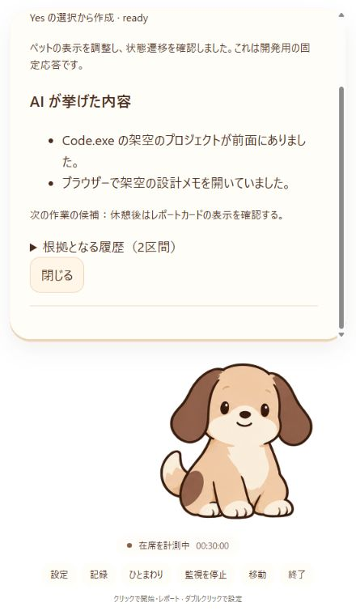

# B-08／B-09：表示統合・復帰処理・デモ確認

作業日：2026-10-18。作業ブランチ：`test/backend-integration`。B-07 (`209cf10`) を `develop/backend` に fast-forward し、A の PR #4 を含む `origin/main` (`31b3b26`) をマージした。B-08 は今回、既存の停止・鮮度・世代管理を活かした軽量実装として追加した。

## 統合した動作

`PochiApp → AppController → AppGateway → TauriGateway → Rust AppService` を唯一の業務経路にした。独立した PochiController と `model.ts` / `repository.ts` / `desktop.ts` を削除した。A の犬・吹き出し・アトラス・姿勢遷移を使い、共通の SettingsPanel / ReportPanel で設定・レポートを表示する。

- **Yes は即時レポート作成**。休憩の開始や起立を UI で断定せず、在席・セッション・時間を保持する。再度の Yes は同じセッションの完成カードを再表示する。
- No は延期だけ。時刻・区切り・60分上限は Rust の既存ルールを使う。
- 自然離席の予約は帰席しても継続し、完成後すぐカードを表示。複数カードは完成順で、表示中の別カードを上書きしない。
- 通知とレポートはアニメーション完了を待たない。同じ通知の毎秒更新・強調更新で再生をやり直さず、古い再生トークンでは業務状態を変えない。
- 起動時は監視オフ。同意後に取得し、再起動で復元するのは設定と保存済みカードだけ。旧手動フローの localStorage は触らない。

IPC の10コマンド・DTO・API v1 は維持。表示用の AppViewModel に `motion`、actions に演出・ウィンドウ操作・再接続を追加。AppGateway の任意の `window` ポートを通じて WindowAdapter に委譲し、表示コンポーネントに Tauri import を置かない。

## ウィンドウ

A の440×760、最小380×640、透過・枠なし・最前面を維持。メインウィンドウだけに最前面・ドラッグ・close・配置・サイズ調整を許可する。終了は停止確認後に close し、停止失敗は表示して再操作できる。OS の終了・ページ再読込は既存 Rust の lifecycle stop でも処理する。

作業領域の右下へ配置し、物理座標・scaleFactor・負座標の別モニターを考慮する。高倍率で初期サイズが作業領域を超えるときだけサイズを収める。吹き出し内をスクロールでき、犬と常設操作を残す。狭幅ブラウザー用の中央寄せ transform がデスクトップで右にはみ出す問題も修正した。

## B-08 の軽量実装

- Windows の Clock は GetTickCount64 を経過時間に使用。スリープを含み、UTC の手動変更では予約を早めない。[Microsoft の時刻仕様](https://learn.microsoft.com/en-us/windows/win32/sysinfo/windows-time)を参照。
- 5秒を超える観測の途切れは既存 Domain の中断処理で、途切れ直前に在席セッションを閉じる。自然離席予約を新たに作らず、既存予約は復帰後に期限を確認して一度だけ実行する。
- ロック・保護画面は既存 Windows 取得の restricted として扱い、在席通知・自然離席予約を新規発行しない。
- UTC を戻した際、新しい顔 sequence が時刻の逆順検証で永久に拒否される問題を修正。受信側時計の変更を確認したときだけ時刻の逆順を許可し、sequence・取得元・前後の鮮度検証は維持する。
- runtime 切替後の新しい操作を、旧操作の遅い finally が解除する競合を修正。表示キュー・読込・演出・pending を旧 runtime から分離する。
- カメラ解放、旧 trackingId の破棄、通信・保存中の停止／削除、StrictMode、再同期は既存テストと合わせて再確認。

専用の Windows 電源メッセージ購読は追加していない。5秒以下の短い停止を明示的な suspend として検出することは、この軽量実装では保証しない。ロック／スリープの実機操作結果も未取得。

## デモ手順（実 API 不要）

```powershell
npm ci
npm run desktop:demo
# 配布用の短縮デモ
npm run desktop:build:demo
```

`--mode demo` と `.env.demo` のみで手動顔入力を組み込む。画面上に「短縮デモ・手動顔入力・実カメラ不使用」を明記する。**PC 情報は実データ**を使う。通常ビルドは実カメラ・通常時間で、URL の `?demo=1` では変更できない。

1. 「作業を記録」→取得・記録の説明にチェック→「ローカル履歴で開始」。上部の「顔あり」を押す。
2. ポチ以外の無害なテスト文書で作業する。顔入力の5サンプルがそろうと在席になる。
3. 在席30秒以降に入力を2秒ほど止めるか、区切りがなくても35秒で通知。No なら作成せず延期し、次の通知で Yes を押す。
4. Yes の直後にカードが完成し、クリックや「記録」から再表示できることを確認。座り続けても在席時間はリセットしない。
5. 別セッションで自然離席も確認する。監視を停止して再開し、顔ありで在席後に「顔なし」。別アプリを前面にしたまま PC 入力も止め、5秒後の離席確定を待つ。確定の5秒後にカードを作成する。途中で顔あり・PC 作業へ戻っても予約は維持する。
6. 「監視を停止」→「終了」。単体 EXE を再起動し、監視オフと保存済みカードの再表示を確認する。

短縮値：離席5秒、初回30〜35秒、No の抑制2秒／上限10秒、強調60秒、その後の No は5秒、Yes 猶予10秒、離席予約5秒。通常値・5サンプルの安定化・入力鮮度は `domain/timings.rs` の既存値を使用する。

通常の単体アプリは `npm run desktop:build`。出力は `src-tauri/target/release/sd_2608.exe`。通常版とデモ版は同じパスなので、保存してから次をビルドする。WebView2 Runtime が入った Windows で、開発サーバーなしで実行する。

AI を実演するときは停止中に接続先・モデル・キーを設定し、開始時に表示された送信先へ同意する。実サービスへの送信は今回未実施。API が使えなければローカル履歴で両経路を実演できる。

## 確認記録

| 確認 | 今回の結果 |
| --- | --- |
| TypeScript 型検査＋Node テスト | 92件成功。Yes の一意性・在席保持・再表示・演出・終了失敗・runtime切替競合を追加 |
| Rust 単体テスト | 96件成功。UTC逆行の顔入力、復帰時の在席中断と既存予約の一回実行を追加 |
| Rust 実コマンド登録の IPC 統合テスト | 1件成功。10コマンド・main限定・開始停止・顔入力・保存を確認 |
| cargo fmt | 成功 |
| 通常／demo のフロントビルド | 成功 |
| ブラウザー操作（MockGateway） | 同意前の開始抑止→同意後の開始→停止、Yes→完成カード、No→作成なし、帰席後の離席予約完成、複数カードの切替を確認。コンソールの error／warn なし |
| 表示領域 | 440×760 と380×640でスクロール・犬・操作ボタンを確認。ネイティブ DPI 検証とは区別 |
| 単体 EXE | 通常版 release と最終ソースの短縮デモ debug をビルド。Vite 停止後、通常版の起動・再起動とデモ版の起動を各4秒確認。取得は開始せず、確認用プロセスだけを終了。UI 操作や正常終了の確認とは区別 |



AC-01〜06 と AC-08 の時刻・一意性・失敗・取消は Domain / AppService / Gateway の自動テストで確認。AC-07 は全107フレームの寸法・時間・逆再生・割り込みと上記の表示確認を実施した。

**手動確認が残る項目**：実カメラの許可／拒否／抜き差し、実 Windows のロック・スリープ・短い停止、ネイティブ透過・ドラッグ・最前面、Windows の100%／125%／150%と複数モニター、単体アプリ上の開始→両レポート経路→終了→再起動、実 Gemini／OpenAI互換API。これらをモックや注入時計で実機検証済みと扱わない。

最初のサンドボックス内 Rust 実行ではローカルソケット・DPAPI／保存制限が発生したため中断し、通常権限で再実行して上記の成功結果を取得した。リリースビルドも MSVC の子プロセス制限を避け、通常権限・並列数2で実行する。

## 固定した成果物

実装コミットは `559694298eb386f23af9ef11464c3c7c60394a84`。ローカルの `artifacts/b09/` に通常版 `Pochi.exe`（release）と、最終表示修正を含む短縮デモ `Pochi-demo-debug.exe`（debug・開発サーバー不要）を保存した。デモの最適化版は `npm run desktop:build:demo` で作成できる。中間ビルドのデモ EXE は配布しない。SHA-256 とソースコミットは同フォルダーの `manifest.json` で固定する。成果物・ログは Git 管理対象外。

最終デモの再現コマンド：`node node_modules/@tauri-apps/cli/tauri.js build --debug --no-bundle --config src-tauri/tauri.demo.conf.json`。通常版の SHA-256 は `59649e852e035308c45d4ba5c1a51a7fa6963a55584c758012f399c3514bf9f4`、短縮デモ debug は `1b5896fb3d8408490cbe873c44925fc50873f2a2262af3f1addf151fd6740f42`。
