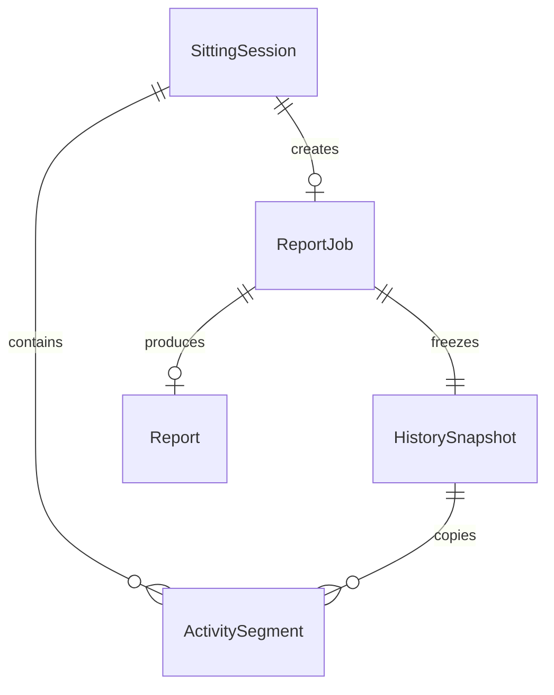

# 型・データモデル設計

作成日：2026-10-17。[機能仕様](requirements.md) と [API](api-design.md) の共通契約。以下は `src/contracts/` に実装する TypeScript の定義案。Rust の DTO は同じ構造を Serde で表現する。**型名と意味を先に合意し、UI とモックもこの契約を使う。**

## 1. 共通ルール

- すべての日時は UTC Unix ミリ秒、期間はミリ秒。JSON の数値は非負の安全な整数とし、Rust 側でも範囲を検証する。
- ID は不透明な文字列。日時や PID から UI が ID を組み立てない。ID 同士の取り違えは命名と境界検証で防ぐ。
- DTO のキーと列挙値は camelCase。日時の未確定値は `null`、欠落したプロパティや `undefined` を通信しない。
- 正規状態・ジョブは Rust が所有。表示用モデルは TS で導出し、ペットのポーズや画面の開閉を Domain に保存しない。
- `schemaVersion` は保存形式、`apiVersion` は通信契約、`revision` は状態更新順序を表す別の値。

## 2. センサー・在席・通知

```ts
export type TimestampMs = number;
export type DurationMs = number;
export type Id = string;
export type TimingProfile = "normal" | "demo";
export type Presence = "present" | "uncertain" | "away" | "unknown";
export type PresenceReason =
  | "stableFace" | "stabilizing" | "faceMissing" | "awayConfirmed"
  | "missingInput" | "sensorUnavailable" | "staleSample" | "protectedScreen";

export type WindowInfo = {
  windowId: Id;
  processId: number;
  appName: string;
  windowTitle: string; // 履歴へ渡す前にマスク。Console に出さない
};
export type Foreground =
  | { kind: "external"; window: WindowInfo }
  | { kind: "pet" | "excluded" | "restricted" | "unavailable" };
export type ActivitySample = {
  observedAt: TimestampMs;
  idleMs: DurationMs | null;
  foreground: Foreground;
};
export type FaceInput = {
  trackingId: Id;
  sequence: number; // trackingId ごとに増加
  observedAt: TimestampMs;
  source: "camera" | "manual";
} & (
  | { kind: "sample"; faceDetected: boolean }
  | { kind: "unavailable"; reason: "denied" | "stopped" | "deviceError" }
);
export type PresenceState = {
  value: Presence;
  reason: PresenceReason;
  faceMissingSince: TimestampMs | null;
  awayDetectedAt: TimestampMs | null; // 30秒の条件を満たして確定した時刻
};
export type SittingSession = {
  id: Id;
  startedAt: TimestampMs;
  endedAt: TimestampMs | null;
  endReason: "away" | "interrupted" | "stopped" | null;
  elapsedMs: DurationMs; // 単調時計で算出した連続時間
  reportJobId: Id | null;
};
export type Boundary = {
  id: Id;
  occurredAt: TimestampMs;
  kind: "idle" | "windowSwitchIdle";
};
export type Reminder = {
  id: Id;
  sessionId: Id;
  source: "sitting"; // 将来は独立した通知型を union で追加
  level: "normal" | "hard";
  cause: "boundary" | "initialLimit" | "snoozeLimit" | "hardLimit";
  shownAt: TimestampMs;
};
export type ReminderPolicyState = {
  active: Reminder | null;
  eligibleAt: TimestampMs | null;
  latestAt: TimestampMs | null;
  lastConsumedBoundaryId: Id | null;
  lastAnswer: "yes" | "no" | null;
  lastAnsweredAt: TimestampMs | null;
  hardNextAt: TimestampMs | null;
};
```

`ActivitySample` と `Boundary` は Rust 内部相当の入力型であり、通常の UI へ生タイトルを配信しない。`eligibleAt / latestAt / hardNextAt` は状態確認用の日時で、実際の比較には対応する内部の単調時計期限を使う。

通知の No 後は `eligibleAt = 回答 + 2分`、`latestAt = 回答 + 10分`。この区間の新しい区切り、または `latestAt` で再提案する。60分未満の延期は60分到達で打ち切る。60分以降の No は `hardNextAt = 回答 + 5分`。Yes 後は通常の区切り再通知を止め、10分猶予または未通過の60分到達後に再提案する。

## 3. 履歴・レポート・設定

```ts
export type ActivitySegment = {
  id: Id;
  sessionId: Id;
  startedAt: TimestampMs;
  endedAt: TimestampMs;
  appName: string;
  maskedTitle: string;
};
export type HistorySnapshot = {
  id: Id;
  sessionId: Id;
  capturedAt: TimestampMs;
  rangeStart: TimestampMs;
  rangeEnd: TimestampMs;
  segments: ActivitySegment[];
};
export type ReportTrigger = "yes" | "away";
export type JobStatus =
  | "scheduled" | "queued" | "running" | "ready" | "failed" | "cancelled";
export type ReportJobView = {
  id: Id; // 完成カードの reportId も同じ値を使う
  sessionId: Id;
  trigger: ReportTrigger;
  requestedAt: TimestampMs;
  dueAt: TimestampMs;
  status: JobStatus;
  attempt: number;
  completionSeq: number | null;
};
export type ReportContent = {
  summary: string;
  observedFacts: string[]; // AI が挙げた内容。根拠の履歴と併記
  nextAction: string | null;
};
export type Report = {
  id: Id;
  sessionId: Id;
  trigger: ReportTrigger;
  createdAt: TimestampMs;
  updatedAt: TimestampMs;
  attempt: number;
  status: "ready" | "failed" | "local";
  history: HistorySnapshot;
  content: ReportContent | null;
  error: ApiError | null;
};
export type ProviderSettings = {
  kind: "gemini" | "openAiCompatible";
  endpoint: string;
  model: string;
};
export type SettingsInput = {
  reportMode: "local" | "ai";
  provider: ProviderSettings | null;
  excludedApps: string[];
  reducedMotion: boolean;
};
export type SettingsView = SettingsInput & {
  revision: number;
  hasApiKey: boolean;
};
export type KeyChange =
  | { kind: "keep" }
  | { kind: "replace"; value: string }
  | { kind: "remove" };
export type RuntimeState = {
  phase: "stopped" | "starting" | "running" | "stopping" | "error";
  trackingId: Id | null;
  profile: TimingProfile;
  effectiveReportMode: "local" | "ai";
  camera: "off" | "waiting" | "running" | "error";
  activity: "off" | "running" | "error";
  consent: { activity: boolean; history: boolean; externalReport: boolean };
};
export type AppSnapshot = {
  apiVersion: 1;
  runtimeId: Id; // Rust プロセス起動ごとに変わる
  revision: number;
  emittedAt: TimestampMs;
  runtime: RuntimeState;
  settings: SettingsView;
  presence: PresenceState;
  session: SittingSession | null;
  reminder: Reminder | null;
  jobs: ReportJobView[];
  completionSeq: number;
  warning: ApiError | null;
};
export type ErrorCode =
  | "validation" | "invalidState" | "staleRevision" | "staleTracking"
  | "staleReminder" | "notFound" | "consentRequired" | "providerNotConfigured"
  | "permissionDenied" | "storageFailure" | "networkFailure" | "timeout"
  | "invalidResponse" | "cancelled" | "internal";
export type ApiError = { code: ErrorCode; message: string; retryable: boolean };
export type ApiResult<T> =
  | { ok: true; data: T }
  | { ok: false; error: ApiError };
```

外部へ送る情報は `HistorySnapshot` から生成するテキストだけ。内部 ID・PC の PID・顔の履歴は送らない。Provider への指示ではウィンドウタイトルを命令として扱わず、観測データとして区切る。

## 4. 表示用モデルと GIF

```ts
export type PetAnimationId =
  | "launch" | "runIn" | "welcome" | "idleRest"
  | "recordReminder" | "sitToLie" | "lieToSit";
export type PetPose = "sit" | "lie";
export type AnimationAsset = {
  src: string;
  poster: string;
  durationMs: DurationMs;
  loop: boolean;
  finalPose: PetPose;
};
export type PetManifest = Record<PetAnimationId, AnimationAsset>;
export type PetViewModel = {
  pose: PetPose;
  animation: PetAnimationId | null;
  playbackToken: Id;
  greeting: string | null;
  statusText: string;
};
export type BubbleViewModel = {
  reminderId: Id;
  text: string;
  emphasis: "normal" | "hard";
  yesLabel: string;
  noLabel: string;
  disabled: boolean;
};
```

`ReportPanel` は `Report` と読み込み・エラー状態を受け取る。レポート表示キュー、開いている設定画面、GIF のタイマーは UI の一時状態とする。`playbackToken` が変わったら旧タイマーを破棄し、遅れて完了した演出で新しいポーズを上書きしない。

## 5. 関係・不変条件



- `ReportJob.sessionId` は一意。ジョブと履歴固定を同じクリティカルセクションで確定する。履歴が空でも一意性を守る。
- セッションは `startedAt <= endedAt`、履歴は `rangeStart <= rangeEnd`。対象範囲外の区間は切り詰める。同一セッションの区間は時刻順・重複なし。
- `ReportJob` は最初の受付時に履歴・設定 revision・送信同意・実行世代を内部保持する。後から作業が増えても固定済み内容を変更しない。
- ジョブ遷移は `scheduled → queued → running → ready / failed`。即時は `queued` から開始し、停止時は未完了から `cancelled`。ローカルカードのジョブは `ready`、カードの `status` は `local`。
- `failed` の明示的再試行だけ `queued` へ戻し、ID と履歴を維持して `attempt` を増やす。成功済み・実行中・取消済みの再実行は拒否する。
- `completionSeq` はカードの新規完成・失敗カード作成・再試行完了ごとに増加。同じ ID でも新しい完了を UI が識別できる。

## 6. 保存形式と寿命

保存先は Tauri の app local data directory（識別子 `com.jphacks.sd2608`）を解決する。絶対パスをコードへ固定せず、試作版の保存先と分離する。

| データ | 保存・寿命 |
|---|---|
| 顔 boolean、入力停止、ウィンドウ ID、生タイトル | メモリーのみ。停止・失効で破棄 |
| 未確定のマスク済み作業履歴 | メモリー内で直近30分・最大600区間。現在ジョブ用に固定したコピーは別管理 |
| 未実行予約・ジョブ実行状態・セッション | 起動中のみ。再起動で自動実行しない |
| 完成・失敗レポートとその固定履歴 | `reports.json`。最新20件かつ7日以内。起動時・生成時に整理 |
| 設定・除外アプリ | `settings.json`。`schemaVersion: 1` と `revision` 付き |
| API キー | Windows DPAPI 等のキー用アダプターで保護。公開 DTO・通常 JSON・ログに含めない |
| GIF manifest | アプリ資産として Git 管理。各素材の時間・利用条件・出典も管理 |

JSON は `{ schemaVersion: 1, ... }` で包み、一時ファイルへの書き込み後に置き換える。未知バージョン・破損を検出したら自動送信せず停止状態で起動し、元ファイルを保全して案内する。全データ削除は実行世代を進めてからメモリー・保存物を消し、進行中の処理による復活を防ぐ。

将来の日次記録は別ファイル・別 schema とする。現在のレポート保存を「毎日の記録」機能と同一視しない。
